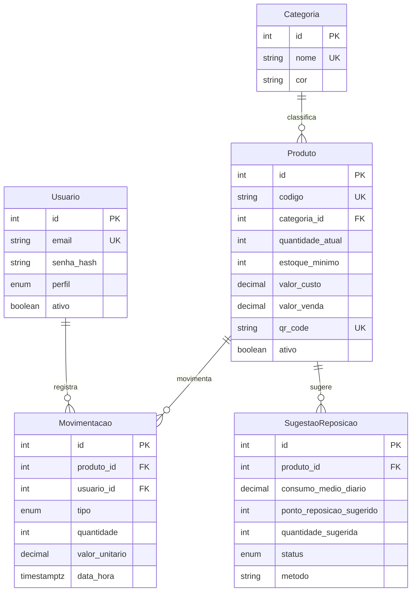

# Banco de dados do StockMind

PostgreSQL no [Neon](https://neon.tech), acessado pelo Prisma ORM 7.10.1. As telas ainda usam os dados locais; esta pasta é só o banco, as migrations e as consultas.

O Prisma 8 ainda é release candidate. Os pacotes `prisma`, `@prisma/client` e `@prisma/adapter-neon` ficam na 7.10.1.

## Configurar o Neon

1. Crie um projeto no Neon (PostgreSQL). Não use Docker.
2. No painel, copie as duas connection strings com `sslmode=require`:
   - **Pooled** (o host contém `-pooler`) vai em `DATABASE_URL`. A aplicação usa esta.
   - **Direct** (sem `-pooler`) vai em `DIRECT_URL`. O `migrate` usa esta.
3. Copie o exemplo e preencha. As duas variáveis ficam só no servidor, sem `NEXT_PUBLIC_`.

```bash
cp .env.example .env
```

O Prisma 7 pede Node.js 20.19+, 22.12+ ou 24+. O arquivo de configuração é `prisma7.config.js` na raiz. A URL de migration fica nele, não no `schema.prisma`.

Crie o `.env` antes do `npm install`. O `postinstall` roda `prisma generate` e o Prisma 7 lê `DIRECT_URL` ao carregar a config. Na Vercel, cadastre as duas variáveis no projeto para o build conseguir gerar o client.

## Comandos

```bash
npm run db:migrate   # prisma migrate dev: aplica a migration no banco de desenvolvimento
npm run db:deploy    # prisma migrate deploy: aplica o que está em prisma/migrations (produção)
npm run db:seed      # categorias, produtos, usuários e 90 dias de movimentações
npm run db:studio    # abre o Prisma Studio
```

Não há `.env` real neste repositório, então a migration inicial foi gerada com `prisma migrate diff` (sem conectar) e completada à mão. Com o `.env` preenchido, `npm run db:migrate` aplica esse arquivo. Se o banco de desenvolvimento já tiver dados e você quiser recomeçar, `npx prisma migrate reset` apaga, reaplica e roda o seed.

O seed pode rodar de novo: usuários, categorias e produtos são atualizados pela chave natural, e o histórico só é inserido se `movimentacoes` estiver vazia. O trigger impede apagar movimentação, então um seed interrompido no meio se resolve com `migrate reset`, não com uma segunda execução.

Usuários de demonstração, a mesma senha da tela de login, gravada só como hash bcrypt (custo 10):

| Perfil | E-mail | Senha |
|---|---|---|
| admin (gestor da tela) | gestor@stockmind.com | 123456 |
| operador | operador@stockmind.com | 123456 |

## Tabelas

Terceira forma normal: a categoria não se repete no produto, e o usuário da movimentação é uma chave, não um nome solto. `valor_unitario` em `movimentacoes` é de propósito um retrato do preço na hora (custo na entrada, venda na saída). Se o preço do produto mudar, o relatório antigo continua válido.

Não há tabela de fornecedor: o prazo de entrega da IA é um parâmetro fixo e a compra aparece só no texto da observação. Não há tabela de alerta: estoque baixo é calculado pela view.

- `usuarios`: nome, e-mail único, `senha_hash`, perfil (`admin` ou `operador`) e `ativo`.
- `categorias`: nome único e a cor usada nos gráficos.
- `produtos`: código único, descrição, categoria, `quantidade_atual`, `estoque_minimo`, `valor_custo`, `valor_venda`, `qr_code` (igual ao código, que é o que o leitor lê) e `ativo` para não apagar quem tem histórico.
- `movimentacoes`: produto, usuário, tipo (`entrada` ou `saida`), quantidade, valor unitário fotografado, observação e `data_hora`.
- `sugestoes_reposicao`: resultado da IA (consumo médio, ponto e quantidade sugeridos, data, status `pendente`/`aceita`/`ignorada` e o método). O seed não grava sugestão.

`quantidade_atual` nasce em 0. Quem altera o saldo é o trigger, na mesma transação da movimentação. Relações com histórico usam `ON DELETE RESTRICT`.

Índices: `produtos(categoria_id)`; `movimentacoes(produto_id, data_hora)`, `(data_hora)` e `(tipo)`; `sugestoes_reposicao(produto_id, data_geracao)` e `(status)`. O índice composto já atende a busca só por produto.

## Regras no banco

Checagens: quantidade e estoque mínimo não negativos, preços não negativos, quantidade da movimentação maior que zero.

- `fn_atualizar_estoque` / `tg_movimentacao_atualiza_estoque`: depois de cada INSERT, trava a linha do produto, soma a entrada ou subtrai a saída. Se a saída deixaria o saldo negativo, a transação inteira falha com `Saldo insuficiente: ... tem só N unidade(s) e a saída pedida é de M.`
- `fn_bloquear_alteracao_movimentacao` / `tg_movimentacao_imutavel`: UPDATE e DELETE em `movimentacoes` são recusados. O histórico é a base dos relatórios e da IA.
- `fn_atualizar_updated_at`: mantém `updated_at` em usuários, categorias, produtos e sugestões. Movimentação não tem essa coluna.

Um `migrate dev` futuro pode sugerir `DROP VIEW` ou `DROP FUNCTION`, porque o `schema.prisma` não descreve esses objetos. Apague essas linhas do SQL novo: eles foram criados de propósito nesta migration.

## Views

Consultas prontas em `src/lib/queries.js`, uma função por view, via `prisma.$queryRaw`. `Decimal` volta como número.

- `vw_produtos_estoque_baixo`: produtos ativos com `quantidade_atual <= estoque_minimo`. É o alerta.
- `vw_valor_total_estoque`: uma linha com a soma a preço de custo, a soma a preço de venda e a quantidade de produtos ativos.
- `vw_movimentacoes_por_periodo`: totais por dia e por tipo, com a coluna `mes` para agregar o mês.
- `vw_movimentacoes_por_produto` e `vw_movimentacoes_por_categoria`: quantidade e valor por tipo.
- `vw_produtos_mais_movimentados`: ranking pela quantidade de saídas.
- `vw_consumo_medio_diario`: média de saídas por dia nas janelas de 30, 60 e 90 dias, por produto.
- `vw_consumo_diario_historico`: uma linha por produto ativo e por dia dos últimos 90 dias, no fuso America/Sao_Paulo. Dia sem saída vale zero. É a série usada pelo desvio e pela sazonalidade.
- Índice único parcial `sugestoes_reposicao_pendente_produto_idx`: no máximo uma sugestão `pendente` por produto. Aceitas e ignoradas podem se repetir no histórico.

## Diagrama


